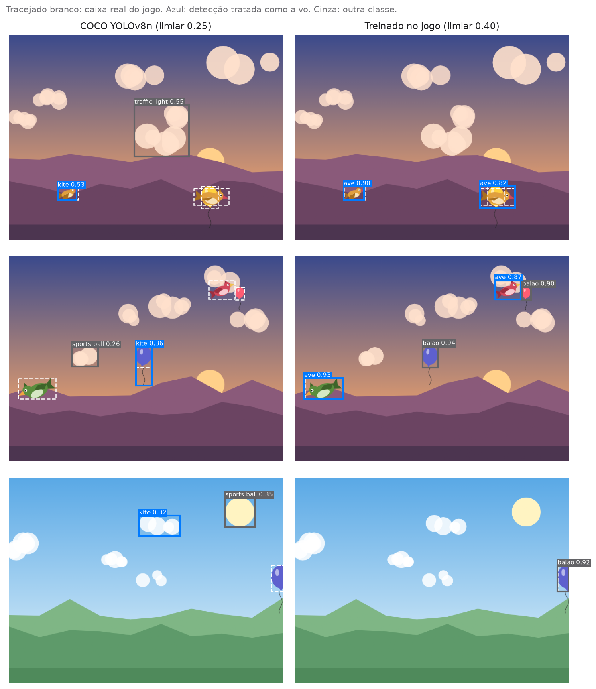

# 🎯 Revoada: como uma IA enxerga um jogo e decide onde clicar

[](https://github.com/YUCAVALCANTE/agente-revoada/actions/workflows/ci.yml)
[](https://yucavalcante.com/agente-revoada/)


Um agente que **só vê os pixels** de um jogo de tiro ao alvo no navegador, detecta os alvos com um modelo de detecção de objetos e decide onde clicar. É a versão com números do artigo [**"Como uma IA enxerga um jogo e decide onde clicar"**](https://medium.com/@yucavalcante/como-uma-ia-enxerga-um-jogo-e-decide-onde-clicar-d70ac633f756) (série **IA sem mágica**, no Medium): lá eu descrevo o exercício da pós em que o detector chamava os patos de *kite*, o limiar de 40%, a regra "maior confiança no centro da caixa" e o problema de "acertar onde o pato estava". Aqui cada um desses pontos vira um experimento medido.

🎮 **[Demo interativa](https://yucavalcante.com/agente-revoada/)**: o jogo rodando, o agente jogando com o detector no seu navegador (Web Worker + onnxruntime-web), as caixas detectadas, a escolha de política, limiar e latência, e um painel de acertos e tempos.

> **Sobre o jogo.** *Revoada* é um jogo **original** feito para este estudo: aves de papel atravessam o céu fazendo curvas (acertar vale ponto) e balões sobem devagar (estourar é penalidade). O exercício que inspirou o artigo, na pós-graduação, usava um jogo clássico de caça a patos; aqui nome, arte, regras e fases são próprios.

## Resumo dos resultados

<!--RESUMO-->

---

## 1. A pergunta

O artigo descreve o ciclo de um agente visual: **capturar a tela → detectar objetos → escolher um alvo → clicar**. Três perguntas viram experimentos:

1. **Um detector pronto (COCO) serve?** Ele nunca viu uma "ave de papel". O que ele enxerga, e quanto acerta?
2. **Quanto ganha um detector treinado no próprio jogo?** E ele generaliza para um cenário que não viu?
3. **Escolher o alvo de maior confiança é uma boa decisão?** Entre a captura do quadro e o clique o alvo continua voando. Quanto a latência custa, e dá para compensar?

## 2. O jogo como gerador de dados rotulados

Como o jogo é meu, ele expõe a verdade de campo: cada alvo é uma lista de polígonos (`web/src/jogo/formas.js`), e **a mesma geometria** gera o desenho e a caixa real. A caixa é exata por construção, sem rotulagem manual.

O gerador (`web/dataset.html`, conduzido pelo Playwright em `python/src/revoada/dataset.py`) desenha cenas aleatórias no canvas e salva PNG + rótulos YOLO:

| Partição | Quadros | Aves | Balões | Cenário |
|---|---:|---:|---:|---|
| treino | 3.000 | 7.639 | 4.471 | dia e entardecer |
| validação | 500 | 1.223 | 727 | dia e entardecer (escolha do limiar) |
| teste | 1.000 | 2.462 | 1.513 | dia e entardecer, sementes novas |
| **teste noite** | 500 | 1.303 | 740 | **noite: cenário que o treino nunca viu** |

Variação: 0 a 5 aves e 0 a 3 balões por quadro, 6 paletas de ave, escala de 0,5× a 1,5×, rumo e batida de asa aleatórios, nuvens na frente dos alvos e alvos cortados pela borda (descartados se menos de 35% visível).

<p align="center"></p>

## 3. Detecção: COCO pronto × treinado no jogo

**Protocolo.** Métricas implementadas do zero em `python/src/revoada/metricas.py` (com testes): casamento guloso por IoU ≥ 0,5, AP com interpolação em todos os pontos (VOC), precisão e recall por limiar. O detector COCO não tem a classe "ave de papel", então pergunto: *se eu tratar certas classes COCO como alvo* (`bird`; `bird` ou `kite`; qualquer classe), quanto ele acerta? O limiar de confiança usado pelo agente é o de **maior F1 na validação**, nunca no teste.

<!--DETECCAO-->

## 4. Decisão: onde clicar

### Políticas comparadas (`web/src/agente/politicas.js`)

| Política | Regra |
|---|---|
| **Maior confiança** (a do artigo) | clica no centro da caixa com maior score |
| **Mais perto da mira** | clica no centro da caixa mais próxima do cursor (menos tempo movendo a mira) |
| **Mira com antecipação** | associa detecções entre quadros (`rastreador.js`), estima a velocidade de cada alvo e mira onde ele **vai estar** quando o tiro sair: centro + velocidade × (latência de percepção + tempo de levar a mira até lá), resolvido por iteração |

### Protocolo do experimento (`python/src/revoada/experimento.py`)

* **Relógio virtual.** O mundo só anda quando o agente gasta tempo. A latência de percepção (captura → decisão) é um parâmetro controlado (0, 50, 100, 200 e 300 ms), não um acidente do hardware; por isso o experimento é determinístico e reprodutível.
* **Detector real.** Cada quadro é desenhado no canvas e enviado ao mesmo Web Worker da demo, com o mesmo ONNX e o mesmo pós-processamento, num Chromium headless.
* **Episódios pareados.** <!--EPISODIOS--> Cada combinação (detector × política × latência) usa as mesmas sementes: mesma partida, só muda a decisão.
* **Mecânica:** mira a 4.000 px/s, 250 ms de recarga entre tiros, até 3 aves e 2 balões na tela. Métrica principal: **precisão** = aves abatidas ÷ tiros. IC de 95% por bootstrap nos episódios.
* **Teto.** Um "detector oráculo" que devolve as caixas reais separa erro de visão de erro de decisão.

<!--POLITICAS-->

## 5. Execução no navegador

```
thread principal                         Web Worker (detector.worker.js)
────────────────                         ───────────────────────────────
jogo em canvas (requestAnimationFrame)
createImageBitmap(canvas) ── transfer ──▶ OffscreenCanvas: letterbox 416×416
                                          RGBA → tensor CHW float32
                                          onnxruntime-web (WebGPU, senão WASM)
                                          pós-processamento YOLOv8 + NMS (yolo.js)
rastreador + política  ◀── caixas ─────── 
move a mira, clica
```

* O quadro vai para o Worker como `ImageBitmap` **transferido** (sem cópia), e todo o pré-processamento roda num `OffscreenCanvas`: o jogo continua fluido enquanto a rede pensa.
* O provedor de execução é escolhido em tempo de execução: WebGPU quando o navegador entrega um adaptador em até 2 s, senão WASM. Se um modelo não carregar, a página troca para o outro detector em vez de deixar o agente parado.
* As caixas são desenhadas **no quadro em que foram vistas**. Com latência alta dá para ver o agente atirando onde a ave estava.

<!--LATENCIA-->

## 6. Limitações

<!--LIMITACOES-->

## 7. Como reproduzir

```bash
# 1) ambiente (Python 3.11+ e Node 20+)
python -m venv .venv && .venv/Scripts/activate        # Linux/macOS: source .venv/bin/activate
pip install -e ".[dev,ml]"
python -m playwright install chromium

# 2) gerar os 5.000 quadros rotulados a partir do próprio jogo
python -m revoada.dataset

# 3) baixar os pesos COCO (yolov8n.pt e yolov8s.pt) em dados/pesos/, treinar e exportar para ONNX
python -m revoada.treinar --epocas 12 --dispositivo cpu        # ou --dispositivo 0 para GPU

# 4) avaliar detectores, rodar o experimento de políticas e gerar figuras
python -m revoada.avaliar
python -m revoada.experimento --sementes 10 --duracao 30
python -m revoada.graficos

# 5) testes e demo local
pytest -q && npm test
node scripts/simular_oraculo.mjs          # políticas com o detector oráculo, só no Node
npm run servir                             # http://localhost:8765
```

### Estrutura

```
web/                       demo publicada no GitHub Pages
  src/jogo/                Revoada: lógica (mundo.js), geometria/caixas reais (formas.js), desenho (render.js)
  src/agente/              pós-processamento YOLO, rastreador, políticas, episódio em relógio virtual
  src/detector.worker.js   Web Worker com onnxruntime-web + OffscreenCanvas
  modelos/                 revoada_yolov8n.onnx (treinado) e coco_yolov8n.onnx (linha de base)
  dataset.html             gerador de quadros rotulados · experimento.html: episódios headless
python/src/revoada/        dataset, treino, métricas, avaliação, experimento, gráficos
reports/                   métricas em JSON e figuras
```

---

Yury Cavalcante · [yucavalcante.com](https://yucavalcante.com) · [LinkedIn](https://www.linkedin.com/in/yucavalcante/)
