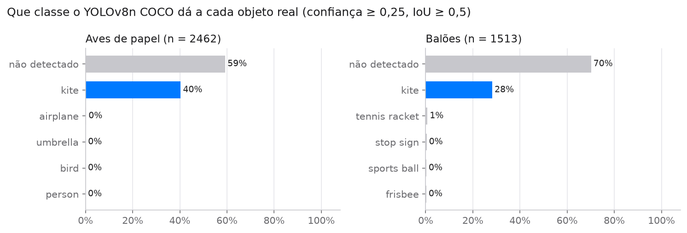
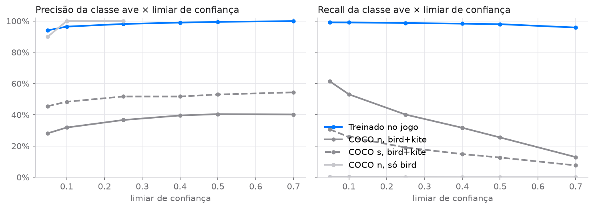
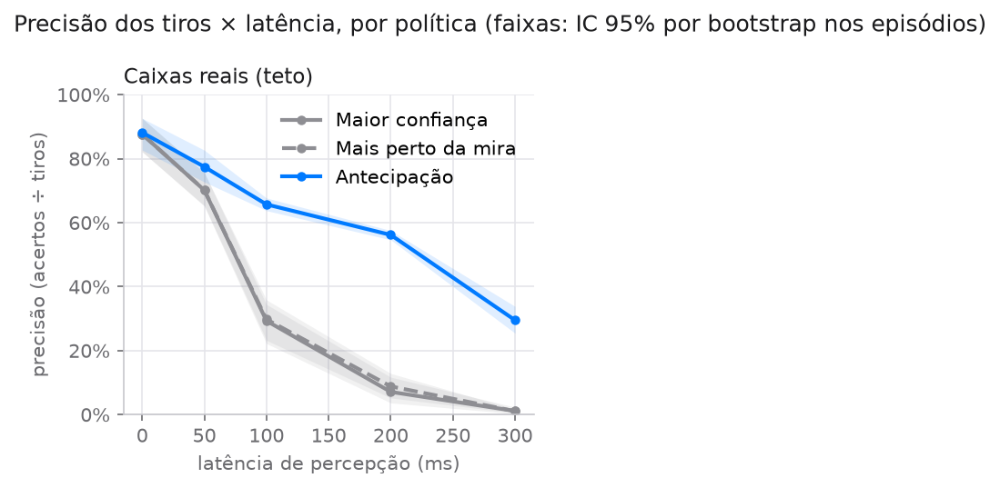
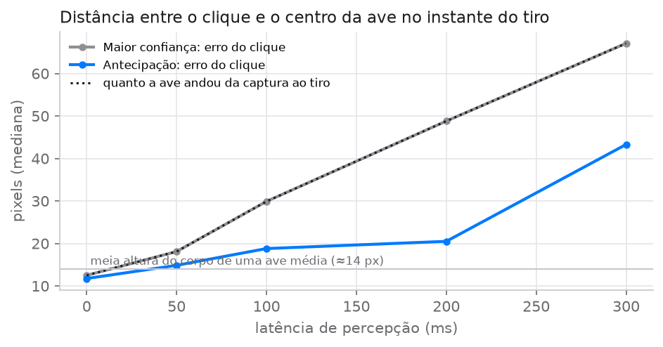

# 🎯 Revoada: como uma IA enxerga um jogo e decide onde clicar

[](https://github.com/YUCAVALCANTE/agente-revoada/actions/workflows/ci.yml)
[](https://yucavalcante.com/agente-revoada/)


Um agente que **só vê os pixels** de um jogo de tiro ao alvo no navegador, detecta os alvos com um modelo de detecção de objetos e decide onde clicar. É a versão com números do artigo [**"Como uma IA enxerga um jogo e decide onde clicar"**](https://medium.com/@yucavalcante/como-uma-ia-enxerga-um-jogo-e-decide-onde-clicar-d70ac633f756) (série **IA sem mágica**, no Medium): lá eu descrevo o exercício da pós em que o detector chamava os patos de *kite*, o limiar de 40%, a regra "maior confiança no centro da caixa" e o problema de "acertar onde o pato estava". Aqui cada um desses pontos vira um experimento medido.

🎮 **[Demo interativa](https://yucavalcante.com/agente-revoada/)**: o jogo rodando, o agente jogando com o detector no seu navegador (Web Worker + onnxruntime-web), as caixas detectadas, a escolha de política, limiar e latência, e um painel de acertos e tempos.

> **Sobre o jogo.** *Revoada* é um jogo **original** feito para este estudo: aves de papel atravessam o céu fazendo curvas (acertar vale ponto) e balões sobem devagar (estourar é penalidade). O exercício que inspirou o artigo, na pós-graduação, usava um jogo clássico de caça a patos; aqui nome, arte, regras e fases são próprios.

## Resumo dos resultados

| Pergunta | Resultado |
|---|---|
| Um detector pronto (YOLOv8n COCO) enxerga as aves de papel? | Mal. Ele chama **40% delas de `kite`** e só **1 em 2.462 de `bird`**; 59% nem são detectadas. Também chama **28% dos balões de `kite`**, então um agente que atira em bird/kite estoura balões. |
| Quanto ele acerta tratando bird/kite como alvo? | **AP@0,5 = 0,27** (640 px) e 0,42 (416 px) no teste. |
| E um YOLOv8n treinado nos quadros do jogo? | **AP@0,5 = 0,994** (ave) e 0,989 (balão) no teste; **0,991** num cenário noturno que o treino nunca viu. Precisão 99% e recall 98% no limiar escolhido na validação. |
| Quanto a latência custa à regra "maior confiança no centro da caixa"? | Mesmo com visão perfeita (caixas reais), a precisão dos tiros cai de **88% sem atraso para 29% com 100 ms e 7% com 200 ms**. |
| Mirar com antecipação resolve? | Em boa parte: **66% com 100 ms e 56% com 200 ms**, nos mesmos episódios. |
| Roda no navegador? | Sim: ONNX no Web Worker com onnxruntime-web. Em CPU (onnxruntime, 1 thread), cada quadro leva ~68 ms. |

> **Pendente:** a comparação das políticas usando os detectores reais (o treinado e o COCO) no lugar das caixas reais não terminou por limite de tempo e de hardware; a seção 4 traz só o agente com visão perfeita.

---

## 1. A pergunta

O artigo descreve o ciclo de um agente visual: **capturar a tela → detectar objetos → escolher um alvo → clicar**. Três perguntas viram experimentos:

1. **Um detector pronto (COCO) serve?** Ele nunca viu uma "ave de papel". O que ele enxerga, e quanto acerta?
2. **Quanto ganha um detector treinado no próprio jogo?** E ele generaliza para um cenário que não viu?
3. **Escolher o alvo de maior confiança é uma boa decisão?** Entre a captura do quadro e o clique o alvo continua voando. Quanto a latência custa, e dá para compensar?

## 2. O jogo como gerador de dados rotulados

Como o jogo é meu, ele expõe a verdade de campo: cada alvo é uma lista de polígonos (`web/src/jogo/formas.js`), e **a mesma geometria** gera o desenho e a caixa real. A caixa é exata por construção, sem rotulagem manual.

O gerador (`web/dataset.html`, conduzido pelo Playwright em `python/src/revoada/dataset.py`) desenha cenas aleatórias no canvas e salva PNG + rótulos YOLO:

| Partição | Quadros | Aves | Balões | Cenário |
|---|---:|---:|---:|---|
| treino | 3.000 | 7.639 | 4.471 | dia e entardecer |
| validação | 500 | 1.223 | 727 | dia e entardecer (escolha do limiar) |
| teste | 1.000 | 2.462 | 1.513 | dia e entardecer, sementes novas |
| **teste noite** | 500 | 1.303 | 740 | **noite: cenário que o treino nunca viu** |

Variação: 0 a 5 aves e 0 a 3 balões por quadro, 6 paletas de ave, escala de 0,5× a 1,5×, rumo e batida de asa aleatórios, nuvens na frente dos alvos e alvos cortados pela borda (descartados se menos de 35% visível).

<p align="center"></p>

## 3. Detecção: COCO pronto × treinado no jogo

**Protocolo.** Métricas implementadas do zero em `python/src/revoada/metricas.py` (com testes): casamento guloso por IoU ≥ 0,5, AP com interpolação em todos os pontos (VOC), precisão e recall por limiar. O detector COCO não tem a classe "ave de papel", então pergunto: *se eu tratar certas classes COCO como alvo* (`bird`; `bird` ou `kite`; qualquer classe), quanto ele acerta? O limiar de confiança usado pelo agente é o de **maior F1 na validação**, nunca no teste.

**Teste (1.000 quadros, dia e entardecer) e teste noturno (500 quadros, cenário fora do treino):**

| Detector (o que conta como "ave") | AP@0,5 teste | AP@0,5 noite | Precisão | Recall |
|---|---:|---:|---:|---:|
| COCO YOLOv8n 640 · só `bird` | 0,009 | 0,038 | — | 0% |
| COCO YOLOv8n 640 · `bird` ou `kite` | 0,268 | 0,375 | 37% | 40% |
| COCO YOLOv8s 640 · `bird` ou `kite` | 0,217 | 0,306 | 52% | 19% |
| COCO YOLOv8n 640 · qualquer classe | 0,219 | 0,083 | 28% | 41% |
| COCO YOLOv8n 416 · `bird` ou `kite` (o da demo) | 0,424 | 0,456 | 49% | 50% |
| **Treinado no jogo YOLOv8n 416 · `ave`** | **0,994** | **0,991** | **99%** | **98%** |

Precisão e recall dos modelos COCO no limiar 0,25; do modelo treinado, no limiar 0,40 (máximo F1 na validação).

<p align="center"></p>
<p align="center"></p>

**Leitura.**

1. **O fenômeno do artigo se repete com números.** O COCO não tem "ave de papel" e escolhe a categoria mais parecida que conhece: `kite`. Só que `kite` também é o nome que ele dá a balões e até a nuvens; usar a classe errada como sinal de mira gera falsos positivos que um agente transformaria em tiros perdidos ou balões estourados.
2. **Um modelo maior não resolve.** O YOLOv8s COCO é mais preciso, mas acha menos aves (recall de 19%).
3. **Treinar no domínio resolve quase tudo**, e o desempenho se mantém à noite. A ressalva: é um mundo sintético e limpo, então 0,99 aqui não diz nada sobre fotos reais (ver Limitações).
4. **Treino curto.** O modelo foi ajustado por 3 épocas em CPU (~1 h) a partir dos pesos COCO; a validação já estava em 0,989 de mAP@0,5 na 1ª época.

## 4. Decisão: onde clicar

### Políticas comparadas (`web/src/agente/politicas.js`)

| Política | Regra |
|---|---|
| **Maior confiança** (a do artigo) | clica no centro da caixa com maior score |
| **Mais perto da mira** | clica no centro da caixa mais próxima do cursor (menos tempo movendo a mira) |
| **Mira com antecipação** | associa detecções entre quadros (`rastreador.js`), estima a velocidade de cada alvo e mira onde ele **vai estar** quando o tiro sair: centro + velocidade × (latência de percepção + tempo de levar a mira até lá), resolvido por iteração |

### Protocolo do experimento (`python/src/revoada/experimento.py`)

* **Relógio virtual.** O mundo só anda quando o agente gasta tempo. A latência de percepção (captura → decisão) é um parâmetro controlado (0, 50, 100, 200 e 300 ms), não um acidente do hardware; por isso o experimento é determinístico e reprodutível.
* **Detector.** O harness (`web/experimento.html`) envia cada quadro ao mesmo Web Worker da demo, com o mesmo ONNX, num Chromium headless. Nesta versão só a rodada com o **detector oráculo** (caixas reais) foi concluída; a rodada com os detectores reais ficou pendente.
* **Episódios pareados.** 6 episódios de 20 s por ponto, com captura de no máximo 15 quadros/s. Cada combinação (detector × política × latência) usa as mesmas sementes: mesma partida, só muda a decisão.
* **Mecânica:** mira a 4.000 px/s, 250 ms de recarga entre tiros, até 3 aves e 2 balões na tela. Métrica principal: **precisão** = aves abatidas ÷ tiros. IC de 95% por bootstrap nos episódios.
* **Teto.** Um "detector oráculo" que devolve as caixas reais separa erro de visão de erro de decisão.

<p align="center"></p>

**Agente com visão perfeita (caixas reais), precisão dos tiros (IC 95%):**

| Latência | Maior confiança | Mais perto da mira | Antecipação |
|---:|---:|---:|---:|
| 0 ms | 88% (82–93) | 88% (82–93) | 88% (83–93) |
| 50 ms | 70% (65–76) | 70% (65–76) | 77% (73–83) |
| 100 ms | 29% (22–34) | 30% (23–36) | **66%** (64–68) |
| 200 ms | 7% (4–12) | 9% (5–13) | **56%** (55–58) |
| 300 ms | 1% (0–2) | 1% (1–2) | **30%** (25–34) |

<p align="center"></p>

**Leitura.**

1. **"Acertar onde o pato estava" é o gargalo, não a visão.** Mesmo com caixas perfeitas, a regra do artigo perde quase tudo a partir de 100 ms: em 200 ms a ave anda ~50 px (mediana) entre a captura e o tiro, mais que o tamanho do corpo dela.
2. **Mais perto da mira quase não ajuda**, porque a mira (4.000 px/s) já é rápida; o atraso que importa é o de percepção.
3. **Antecipar mantém o agente útil até ~200 ms.** Acima disso a ave faz curvas entre a captura e o tiro e o modelo de velocidade constante falha (30% em 300 ms).
4. Com latência zero as três empatam: sem atraso, mirar no centro já basta.

## 5. Execução no navegador

```
thread principal                         Web Worker (detector.worker.js)
────────────────                         ───────────────────────────────
jogo em canvas (requestAnimationFrame)
createImageBitmap(canvas) ── transfer ──▶ OffscreenCanvas: letterbox 416×416
                                          RGBA → tensor CHW float32
                                          onnxruntime-web (WebGPU, senão WASM)
                                          pós-processamento YOLOv8 + NMS (yolo.js)
rastreador + política  ◀── caixas ─────── 
move a mira, clica
```

* O quadro vai para o Worker como `ImageBitmap` **transferido** (sem cópia), e todo o pré-processamento roda num `OffscreenCanvas`: o jogo continua fluido enquanto a rede pensa.
* O provedor de execução é escolhido em tempo de execução: WebGPU quando o navegador entrega um adaptador em até 2 s, senão WASM. Se um modelo não carregar, a página troca para o outro detector em vez de deixar o agente parado.
* As caixas são desenhadas **no quadro em que foram vistas**. Com latência alta dá para ver o agente atirando onde a ave estava.

**Tempo de inferência (ONNX, 416×416, onnxruntime em CPU de notebook):** treinado no jogo, 68 ms com 1 thread e 42 ms com todas; COCO, 75 ms e 31 ms. No navegador, o painel da demo mostra o tempo medido no seu aparelho.

## 6. Limitações

* **Mundo sintético.** As aves são poucas formas geométricas com 6 paletas; o detector treinado acerta 99% porque o problema é fácil e o teste vem do mesmo gerador (com sementes novas). O teste noturno mede só uma mudança de cenário; não há fotos reais.
* **Políticas com detectores reais: pendente.** A rodada do experimento com o detector treinado e com o COCO no lugar das caixas reais não terminou. Com o COCO, o esperado é a precisão cair bem mais (recall de 50% e balões confundidos com `kite`).
* **Treino curto e em CPU**: 3 épocas, sem busca de hiperparâmetros.
* **Modelo de movimento simples.** A antecipação supõe velocidade constante entre quadros; um filtro de Kalman deve render mais em latências altas.
* **O agente não aprende.** As políticas são regras fixas, como no artigo; aprendizado por reforço fica como próximo passo.
* **Uma máquina só.** Os tempos de inferência são de um notebook; o painel da demo mede o seu.

## 7. Como reproduzir

```bash
# 1) ambiente (Python 3.11+ e Node 20+)
python -m venv .venv && .venv/Scripts/activate        # Linux/macOS: source .venv/bin/activate
pip install -e ".[dev,ml]"
python -m playwright install chromium

# 2) gerar os 5.000 quadros rotulados a partir do próprio jogo
python -m revoada.dataset

# 3) baixar os pesos COCO (yolov8n.pt e yolov8s.pt) em dados/pesos/, treinar e exportar para ONNX
python -m revoada.treinar --epocas 3 --lote 8 --workers 0     # CPU; com GPU: --dispositivo 0 e mais épocas

# 4) avaliar detectores, rodar o experimento de políticas e gerar figuras
python -m revoada.avaliar
python -m revoada.experimento --sementes 6 --duracao 20
python -m revoada.graficos

# 5) testes e demo local
pytest -q && npm test
node scripts/simular_oraculo.mjs          # políticas com o detector oráculo, só no Node
npm run servir                             # http://localhost:8765
```

### Estrutura

```
web/                       demo publicada no GitHub Pages
  src/jogo/                Revoada: lógica (mundo.js), geometria/caixas reais (formas.js), desenho (render.js)
  src/agente/              pós-processamento YOLO, rastreador, políticas, episódio em relógio virtual
  src/detector.worker.js   Web Worker com onnxruntime-web + OffscreenCanvas
  modelos/                 revoada_yolov8n.onnx (treinado) e coco_yolov8n.onnx (linha de base)
  dataset.html             gerador de quadros rotulados · experimento.html: episódios headless
python/src/revoada/        dataset, treino, métricas, avaliação, experimento, gráficos
reports/                   métricas em JSON e figuras
```

---

Yury Cavalcante · [yucavalcante.com](https://yucavalcante.com) · [LinkedIn](https://www.linkedin.com/in/yucavalcante/)
